<div align="center">


# MediCare Clinic App

**A full-stack clinic management app for patients, doctors and admins.**
Book doctors, run the day's appointments, write prescriptions, keep medical records and handle billing. One React Native app runs on Android, iOS and the web, backed by a Node.js + MongoDB API.


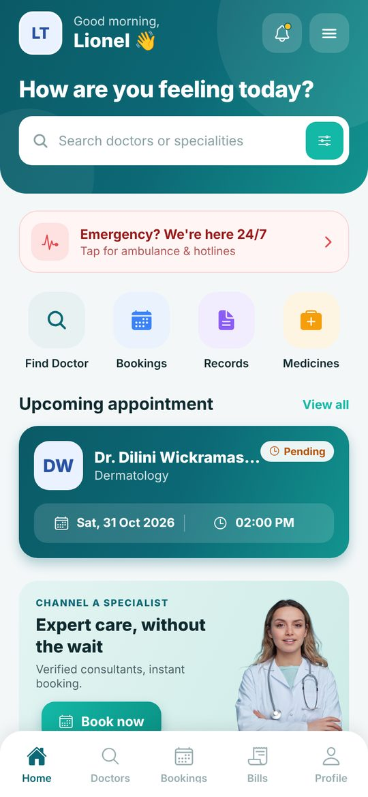
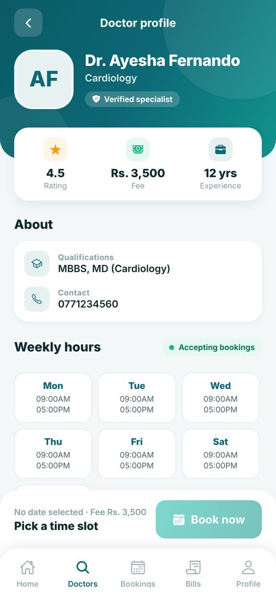
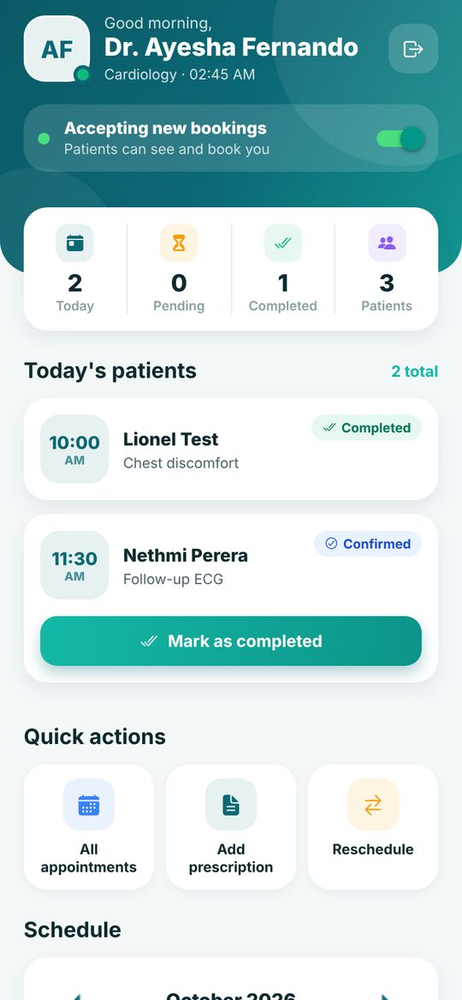
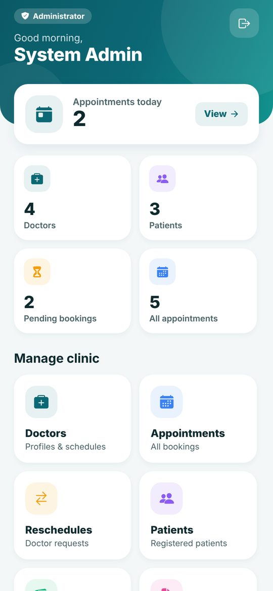

</div>

---

## Contents

1. [Features by role](#1-features-by-role)
2. [Tech stack](#2-tech-stack)
3. [System architecture](#3-system-architecture)
4. [Backend: how a request flows](#4-backend-how-a-request-flows)
5. [Frontend: how the app flows](#5-frontend-how-the-app-flows)
6. [Core workflows, step by step](#6-core-workflows-step-by-step)
7. [Data model](#7-data-model)
8. [REST API reference](#8-rest-api-reference)
9. [Screenshots](#9-screenshots)
10. [Project structure](#10-project-structure)
11. [Run it locally](#11-run-it-locally)
12. [Deploy the backend](#12-deploy-the-backend)
13. [Security and business rules](#13-security-and-business-rules)

---

## 1. Features by role

| 👤 Patient | 🩺 Doctor | 🛡️ Admin |
|---|---|---|
| Register and sign in | Dashboard with today's patients and stats | Clinic dashboard (today's bookings, doctors, patients, pending) |
| Search and filter doctors by specialty | Toggle "Accepting new bookings" | Add, edit or deactivate doctors (photo, schedule, **consultation fee**) |
| Doctor profile: rating, fee, experience, weekly hours | Confirm, complete or cancel appointments | Approve or reject doctors' reschedule requests |
| Calendar + time-slot booking | Request a reschedule (sent to admin) | Manage patients (deactivating one blocks their login) |
| Edit or cancel own bookings | Write and edit prescriptions | View all appointments, prescriptions and medical records |
| Bills: outstanding vs paid, **Pay now** | View a patient's medical records | Create and manage invoices, mark them paid |
| Prescriptions and medical records (upload) | Calendar view of the schedule | Clinic settings: booking window, holidays |
| Rate a doctor after a visit | | |

All messages (success, errors, confirmations) appear as **in-app pop-up cards** on every platform.

---

## 2. Tech stack

| Layer | Technology | Why it's used |
|---|---|---|
| **Mobile / web app** | Expo SDK 54, React Native 0.81, React 19 | One codebase for Android, iOS and the web |
| Navigation | React Navigation 7 (native stack + bottom tabs) | A separate navigator per role, with nested stacks for each tab |
| HTTP client | Axios with interceptors | Adds the JWT, refreshes it on 401, gives friendly error messages |
| Local storage | AsyncStorage | Access/refresh tokens and the cached user for instant start-up |
| Forms | Formik + Yup, custom validators | Live validation (password strength, phone, DOB) |
| UI | expo-linear-gradient, @expo/vector-icons, react-native-calendars | Gradient headers, icons, booking calendar |
| Files | expo-image-picker, expo-document-picker | Profile photos and medical-record uploads |
| **API server** | Node.js ≥ 20, Express 5 | REST API |
| Database | MongoDB Atlas with Mongoose 9 | Documents for users, doctors, appointments, bills and more |
| Auth | jsonwebtoken + bcryptjs | 1 h access token, 7 d refresh token, hashed passwords |
| Validation | express-validator | Request-body rules per route (returns 422 with field errors) |
| Uploads | multer (memory) → Cloudinary (or local disk in dev) | Works on serverless hosts that have no disk |
| Hosting | Vercel (serverless function, `sin1` region) or Render | Free tiers. Database on MongoDB Atlas M0 |

---

## 3. System architecture

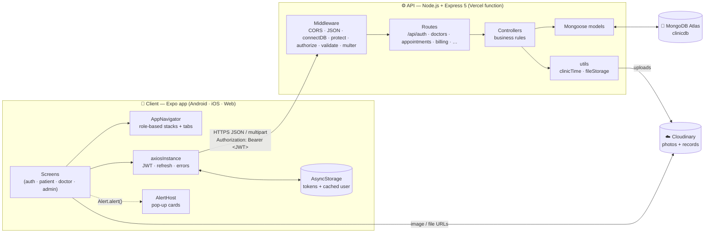

**Three tiers:**

1. **Presentation (Expo app).** Screens only talk to the API through one Axios instance. The signed-in user's role decides which navigator is mounted.
2. **Application (Express API).** Stateless. Every request carries a JWT, so the same code runs as a long-lived server (local or Render) or as a serverless function (Vercel).
3. **Data (MongoDB Atlas + Cloudinary).** Structured data is in MongoDB. Binary files are in Cloudinary, and only their URLs are stored in MongoDB.

---

## 4. Backend: how a request flows

Every API call passes through the same pipeline in `backend/server.js`:

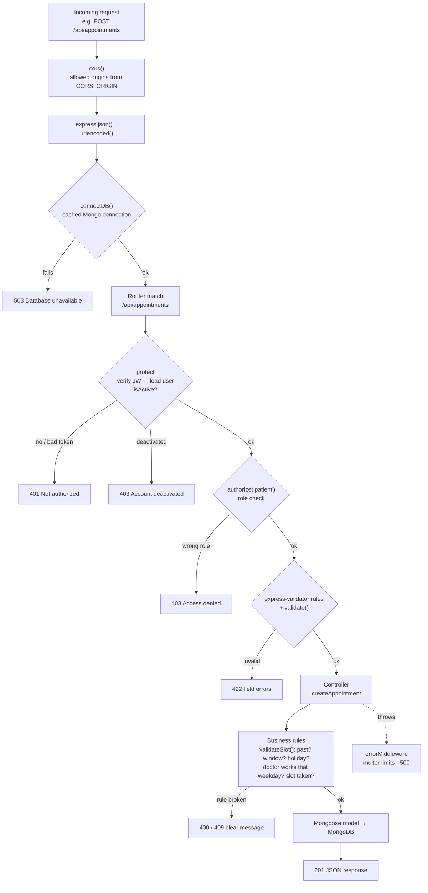

### Startup sequence

| Step | What happens | Where |
|---|---|---|
| 1 | Load `.env` and check `MONGO_URI`, `JWT_SECRET`, `JWT_REFRESH_SECRET` | `server.js` |
| 2 | Build the Express app (CORS, body parsers, `/uploads` static) | `server.js` |
| 3 | First `/api` request → `connectDB()` opens one Mongo connection and reuses it across serverless calls | `server.js` |
| 4 | `ensureDefaultAdmin()` creates the admin from `ADMIN_EMAIL` / `ADMIN_PASSWORD` if missing | `server.js` |
| 5 | Locally: `app.listen(PORT)`. On Vercel: the exported `app` is the function handler | `server.js` |

### Backend layers

| Layer | Folder | Responsibility |
|---|---|---|
| Routes | `routes/` | URL + HTTP verb → middleware chain → controller |
| Middleware | `middleware/` | `protect` (JWT + active account), `authorize(...roles)`, `validate` + `validators/`, `uploadMiddleware` (multer, size and type limits), `errorMiddleware` |
| Controllers | `controllers/` | Business logic: slot validation, access scoping (patients see only their own data), auto-billing, soft deletes |
| Models | `models/` | Mongoose schemas with validation and indexes |
| Utils | `utils/clinicTime.js` | All "today / weekday / holiday" maths in **clinic time (UTC+05:30)**, independent of the server's timezone |
| | `utils/fileStorage.js` | Saves an upload to Cloudinary (if keys are set) or to `uploads/` locally |

---

## 5. Frontend: how the app flows

### App start-up and role routing

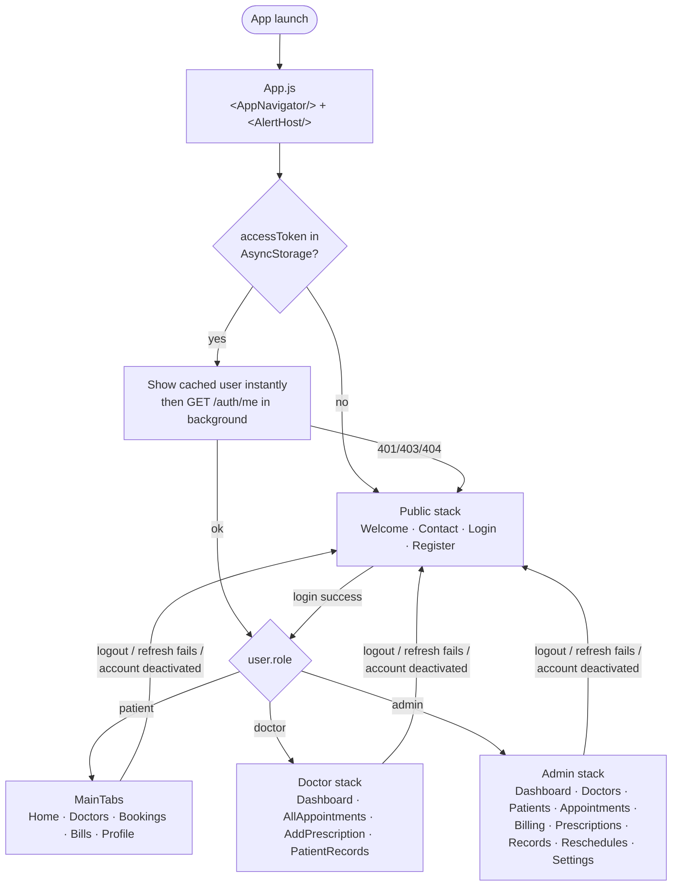

### Navigation map (patient)

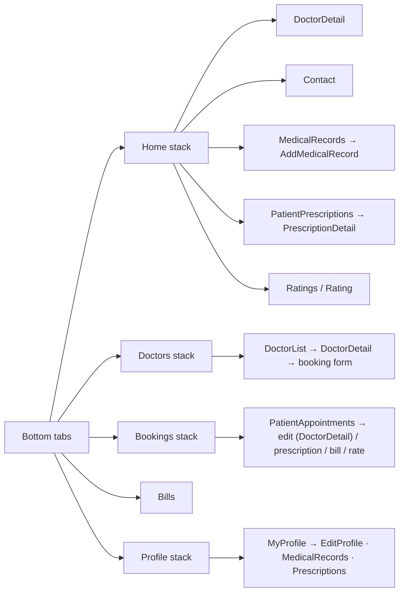

### Frontend building blocks

| File | Role |
|---|---|
| `App.js` | Root: mounts the navigator and the global `AlertHost` |
| `src/navigation/AppNavigator.js` | Auth check, role-based stacks and tabs, login/logout handlers |
| `src/api/axiosInstance.js` | Base URL from `EXPO_PUBLIC_API_URL`. Attaches the token, retries once after refreshing on **401**, signs out on refresh failure or a deactivated account. `getErrorMessage()` and `buildServerUrl()` |
| `src/components/AlertHost.js` | Replaces `Alert.alert` with styled pop-up cards (success, error, warning, question, info), picked from the message wording |
| `src/components/ui.js` | Design system: `GradientHeader`, `Card`, `Button`, `StatusBadge`, `EmptyState`, `InfoRow`, … |
| `src/components/DateField.js` | Date picker that uses the native dialog on phones and `<input type="date">` on the web |
| `src/theme.js` | Colours, gradients, radius, shadows, status colours, helpers |
| `src/utils/date.js` | Local date keys and helpers shared by screens |

### Token lifecycle (client side)

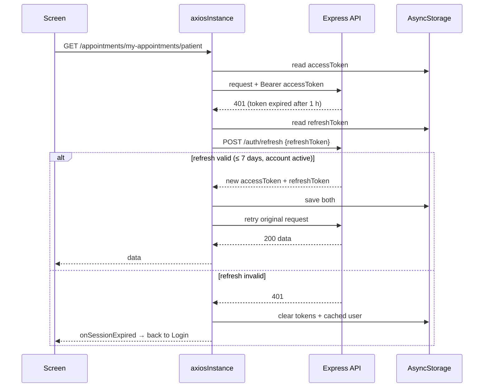

---

## 6. Core workflows, step by step

### 6.1 Register → Sign in

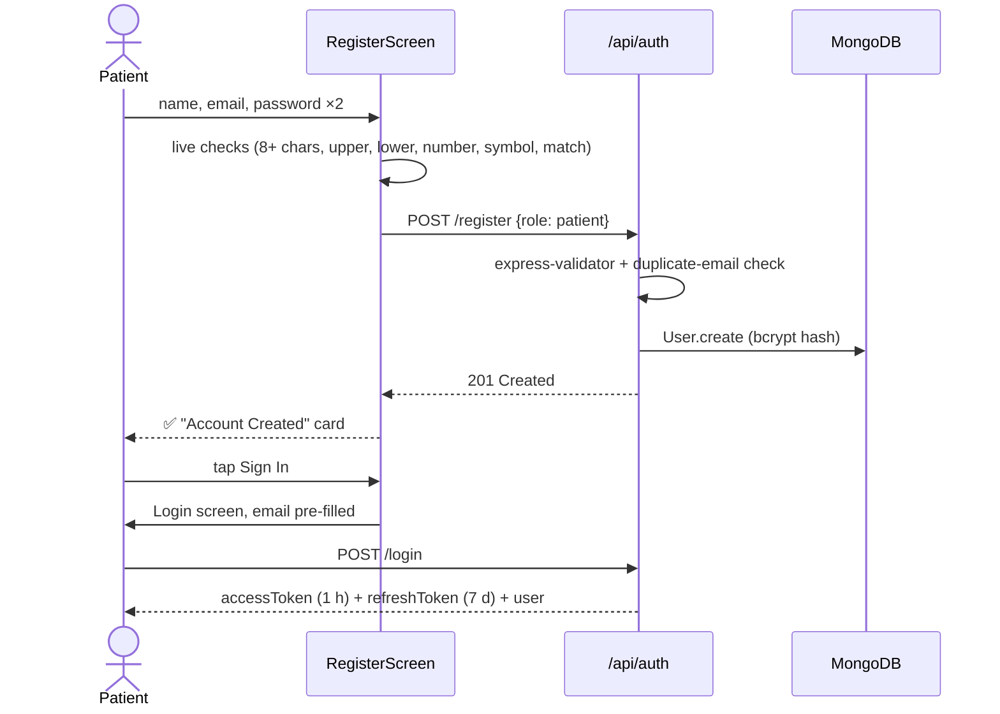

### 6.2 Booking an appointment

1. **Doctors tab** → search or filter by specialty → open a doctor (rating, **fee**, experience, weekly hours).
2. **Choose a date** on the calendar. Days the doctor doesn't work, holidays and days outside the booking window are greyed out.
3. **Choose a time** slot → **Book now** → the booking form opens, pre-filled from the patient's profile (name, DOB, gender, address).
4. **Confirm booking** → `POST /api/appointments`.
5. The server runs `validateSlot()`:

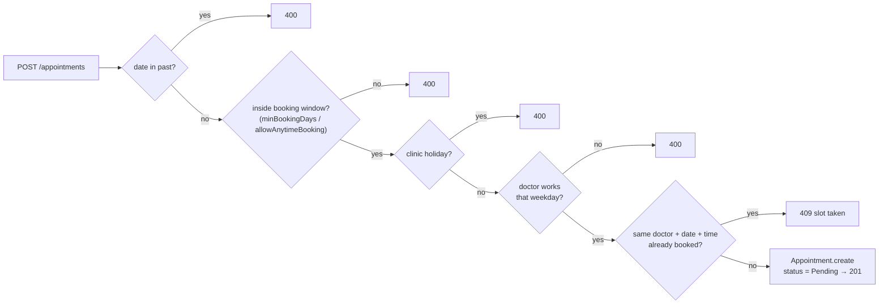

6. The patient sees a **Booking Confirmed** card, and the visit appears under **Bookings → Upcoming**.

### 6.3 Appointment lifecycle and auto-billing

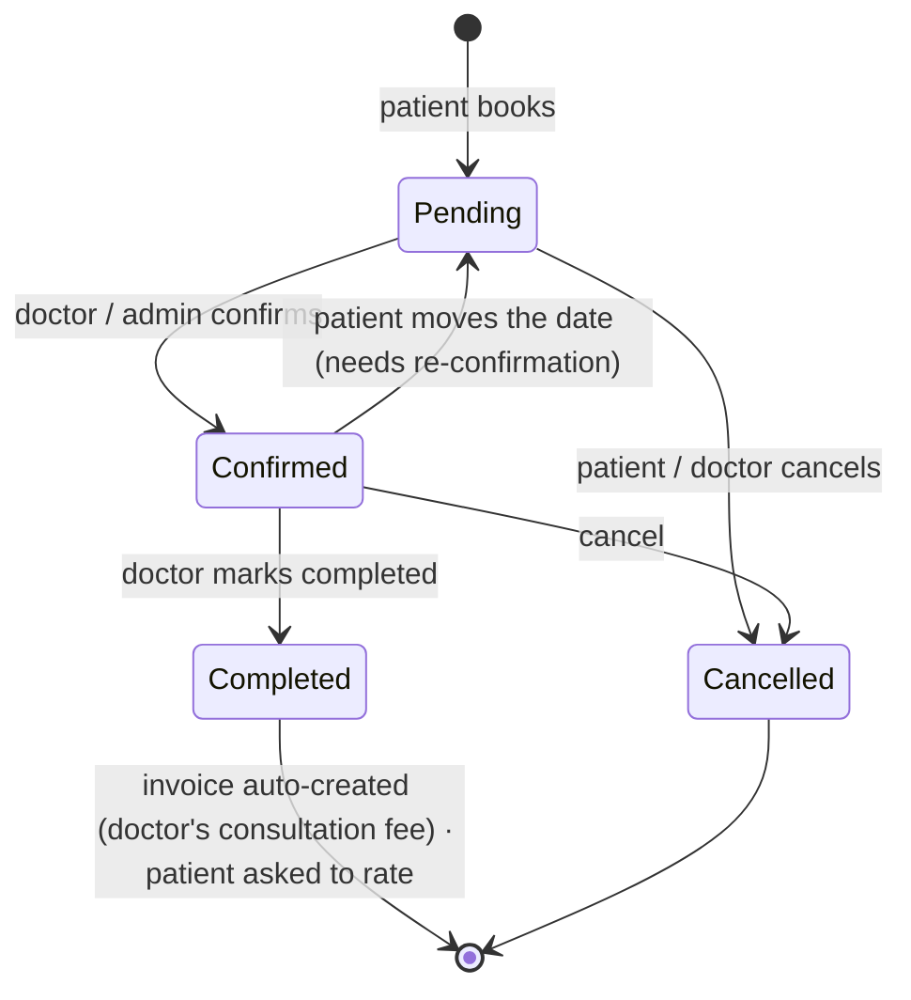

- Patients and doctors can only **cancel** (a soft delete). Only an admin can permanently delete.
- When an appointment becomes **Completed**, the server creates a **Pending invoice** for the doctor's own `consultationFee`. The patient sees it under **Bills** and can tap **Pay now**. An admin can also mark it paid (cash).

### 6.4 Reschedule request (doctor → admin)

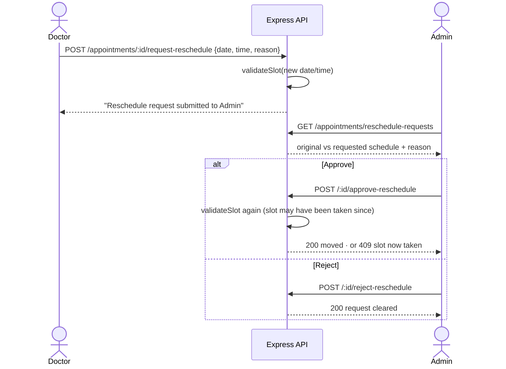

### 6.5 Prescriptions, records and reviews

| Flow | Steps |
|---|---|
| **Prescription** | Doctor opens a completed or confirmed visit → *Add prescription* (diagnosis, medications × dosage, frequency, duration, instructions) → `POST /prescriptions` → patient sees it in *Prescriptions* and on the visit |
| **Medical record** | Patient (or doctor) picks a file → multipart `POST /medical-records` → multer (memory) → `fileStorage.saveFile()` → Cloudinary URL saved → listed under *Medical records* |
| **Review** | After a completed visit the home screen asks *"How was your visit?"* → star ratings for the doctor and the clinic, plus a comment → `POST /reviews` → doctor's average rating updates on the list and profile |
| **Deactivate patient** | Admin deletes a patient → `User.isActive = false` → their next request gets **403** → the app signs them out, and they can't log in or book |

---

## 7. Data model

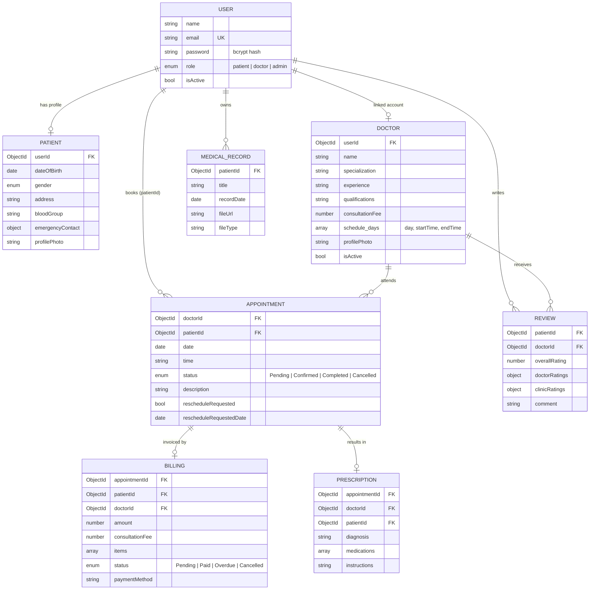

Two more standalone collections: **GlobalSetting** (`allowAnytimeBooking`, `minBookingDays`, default 3) and **Holiday** (`date` YYYY-MM-DD, `name`, `type`).

---

## 8. REST API reference

Base URL: `https://<your-host>/api` · 🔓 public · 🔐 any signed-in user · **P** patient · **D** doctor · **A** admin

<details>
<summary><b>Auth</b> — <code>/api/auth</code></summary>

| Method | Path | Access | Purpose |
|---|---|---|---|
| POST | `/register` | 🔓 | Create a patient account |
| POST | `/login` | 🔓 | Returns `accessToken`, `refreshToken`, `user` |
| POST | `/refresh` | 🔓 | Swap a refresh token for new tokens |
| GET | `/me` | 🔐 | Current user |
| POST | `/create-doctor` | A | Create a doctor login |
</details>

<details>
<summary><b>Doctors</b> — <code>/api/doctors</code></summary>

| Method | Path | Access | Purpose |
|---|---|---|---|
| GET | `/` | 🔓 | Active doctors with ratings |
| GET | `/:id` | 🔓 | One doctor |
| POST | `/` | A | Create (multipart, `profilePhoto`) |
| PUT | `/:id` | A | Update (incl. `consultationFee`, schedule) |
| DELETE | `/:id` | A | Remove |
| GET | `/admin/stats` | A | Dashboard counters |
| GET | `/admin/all` | A | All doctors incl. inactive |
| GET | `/my-profile` | D | Own doctor profile |
| PUT | `/my-profile/status` | D | Accepting bookings on/off |
</details>

<details>
<summary><b>Appointments</b> — <code>/api/appointments</code></summary>

| Method | Path | Access | Purpose |
|---|---|---|---|
| POST | `/` | P | Book (runs `validateSlot`) |
| GET | `/my-appointments/patient` | P | Own bookings |
| GET | `/my-appointments/doctor` | D | Doctor's bookings |
| GET | `/` | 🔐 | Scoped to the caller (admin sees all) |
| GET | `/:id` | 🔐 | One appointment (owner / doctor / admin) |
| PUT | `/:id` | 🔐 | Edit / move (re-validated) |
| PUT | `/:id/status` | D, A | Confirm / complete / cancel (Completed → auto invoice) |
| POST | `/:id/request-reschedule` | D | Ask admin to move it |
| GET | `/reschedule-requests` | A | Pending requests |
| POST | `/:id/approve-reschedule` | A | Approve (re-checks the slot) |
| POST | `/:id/reject-reschedule` | A | Reject |
| DELETE | `/:id` | 🔐 | Patient/doctor → cancel · admin → delete |
</details>

<details>
<summary><b>Patients · Billing · Prescriptions · Records · Reviews · Settings · Holidays</b></summary>

| Method | Path | Access | Purpose |
|---|---|---|---|
| GET/POST/PUT | `/patients/profile` | P | Own profile (multipart photo) |
| GET | `/patients`, `/patients/:id` | D, A | Patient list / details |
| DELETE | `/patients/:id` | A | Deactivate patient |
| GET | `/billing/my-billing` | P | Own invoices |
| GET | `/billing/by-appointment/:id` | 🔐 | Invoice for a visit |
| POST · GET · DELETE | `/billing`, `/billing/:id` | A | Create / list / delete invoices |
| PUT | `/billing/:id/status` | P (own, pay) · A | Mark paid |
| POST | `/prescriptions` | D | Write a prescription |
| GET | `/prescriptions/my-prescriptions` | P | Own prescriptions |
| GET | `/prescriptions/appointment/:id` | 🔐 | For one visit |
| GET · PUT · DELETE | `/prescriptions/:id` | D, A | Manage |
| POST | `/medical-records` | P, D | Upload (multipart `file`) |
| GET | `/medical-records/my-records` | P | Own records |
| GET | `/medical-records/patient/:id` | D, A | A patient's records |
| GET | `/reviews`, `/reviews/doctor/:id` | 🔓 | Ratings |
| POST | `/reviews` | P | Rate a doctor |
| GET · PUT | `/settings` | 🔓 · A | Booking window |
| GET · POST · DELETE | `/holidays` | 🔓 · A | Clinic holidays |
| GET | `/health` | 🔓 | API + DB status, file storage mode |
</details>

**Error format:** `{ "message": "…" }`, or `{ "success": false, "errors": [{ "field", "message" }] }` for validation errors (422).

---

## 9. Screenshots

> Captured from the running app (web build) with demo data.

### Getting started

<table>
<tr>
<td align="center">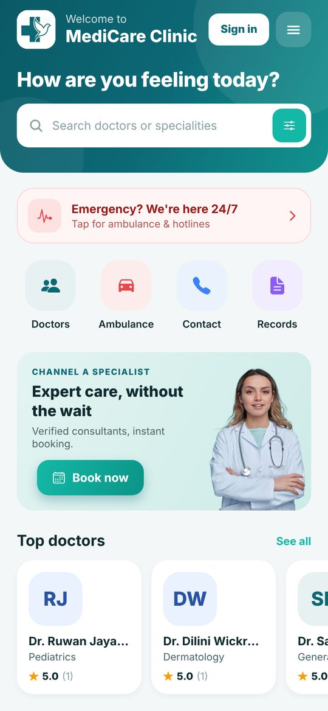<br/><sub>Welcome (public)</sub></td>
<td align="center">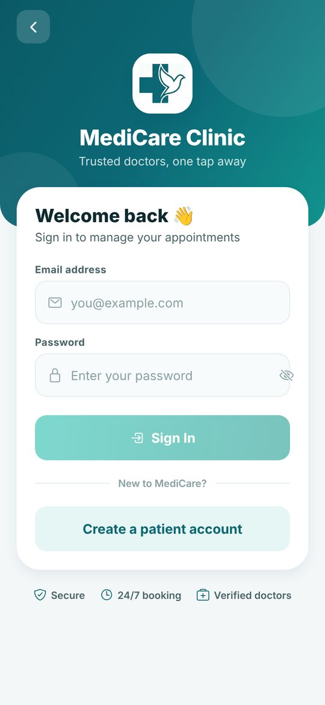<br/><sub>Sign in</sub></td>
<td align="center">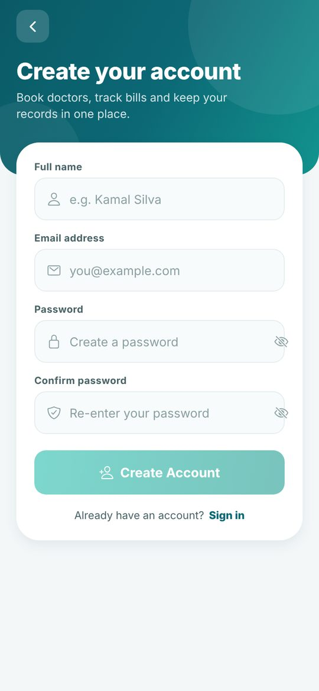<br/><sub>Register with live password checks</sub></td>
</tr>
<tr>
<td align="center">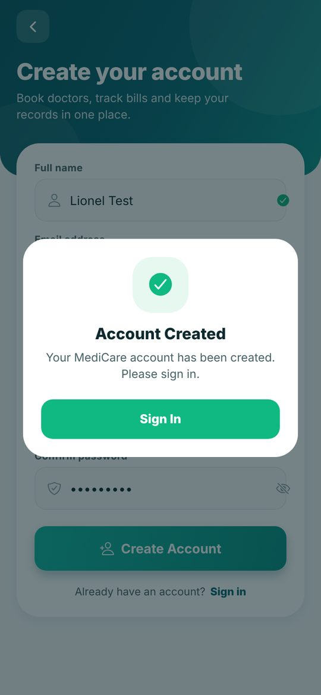<br/><sub>Success card → back to Sign in</sub></td>
<td align="center">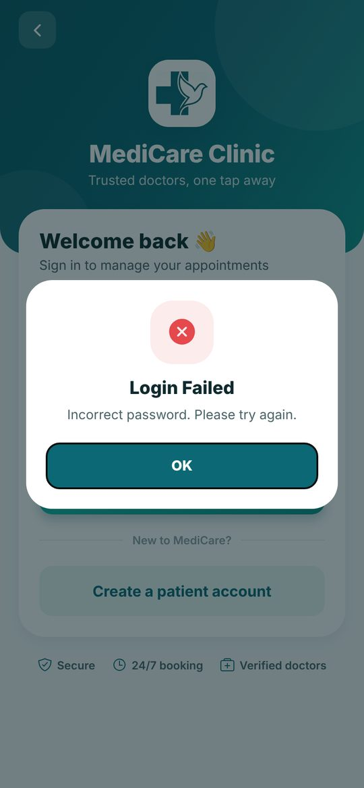<br/><sub>Error card (wrong password)</sub></td>
<td align="center">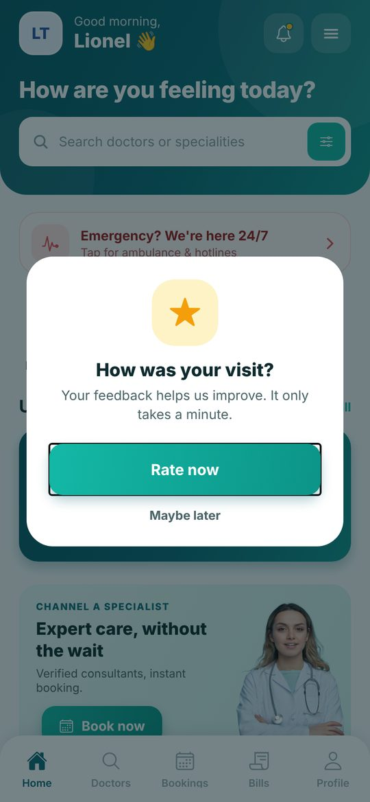<br/><sub>"How was your visit?" prompt</sub></td>
</tr>
</table>

### Patient: find a doctor and book

<table>
<tr>
<td align="center"><br/><sub>1 · Home</sub></td>
<td align="center">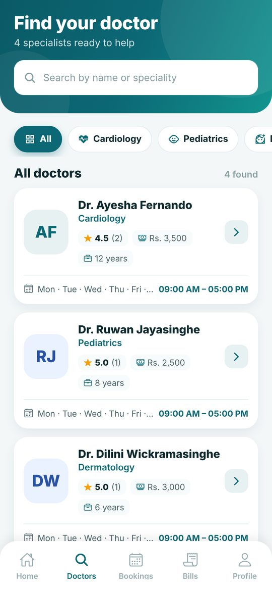<br/><sub>2 · Find a doctor (fee + rating)</sub></td>
<td align="center"><br/><sub>3 · Doctor profile</sub></td>
</tr>
<tr>
<td align="center">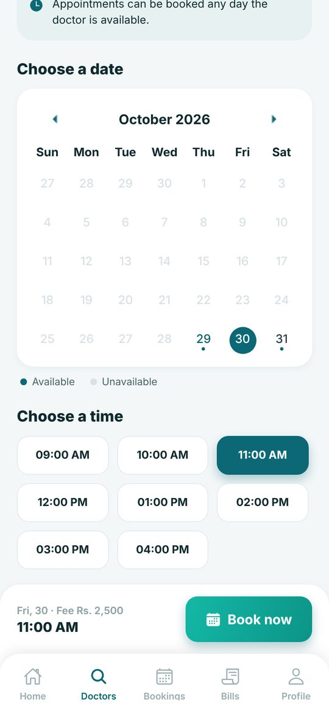<br/><sub>4 · Choose date + time</sub></td>
<td align="center">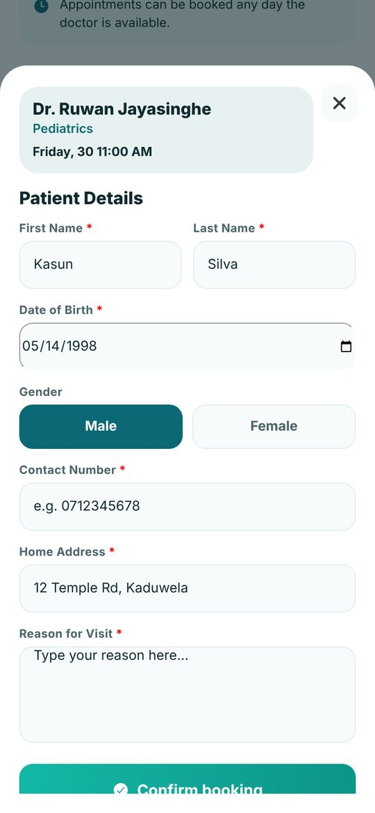<br/><sub>5 · Details (pre-filled)</sub></td>
<td align="center">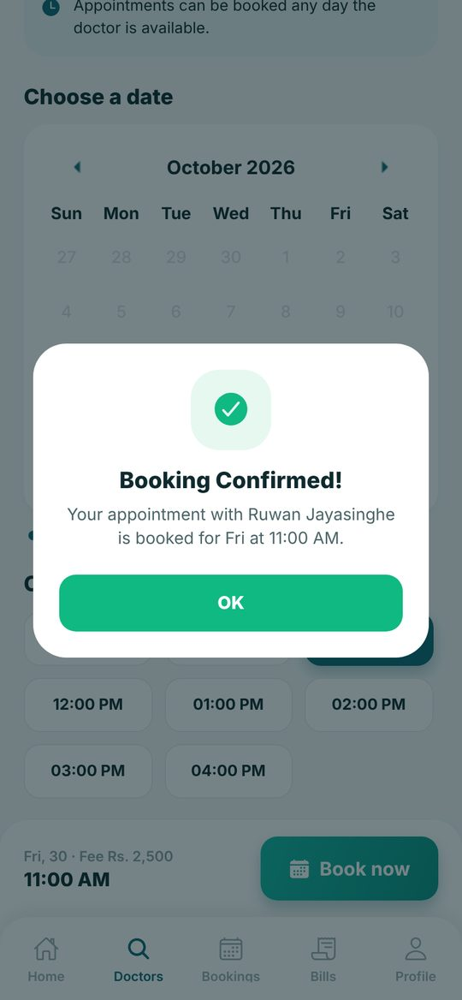<br/><sub>6 · Booking confirmed</sub></td>
</tr>
</table>

### Patient: bookings, bills and profile

<table>
<tr>
<td align="center">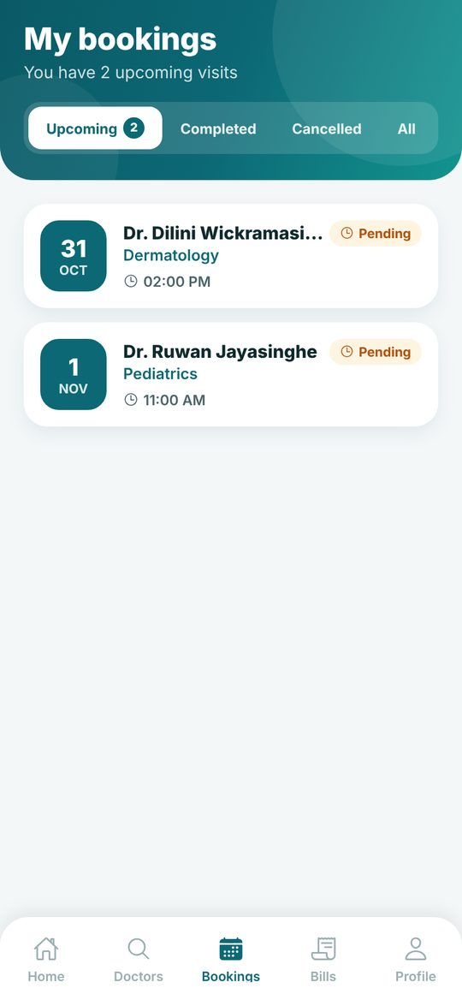<br/><sub>My bookings</sub></td>
<td align="center">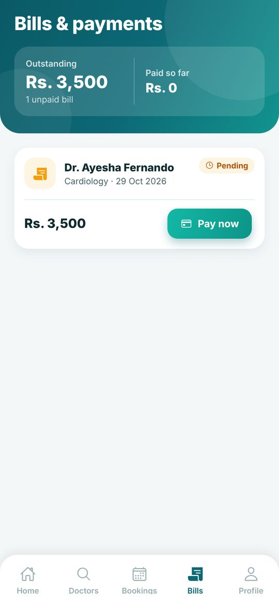<br/><sub>Bills and Pay now</sub></td>
<td align="center">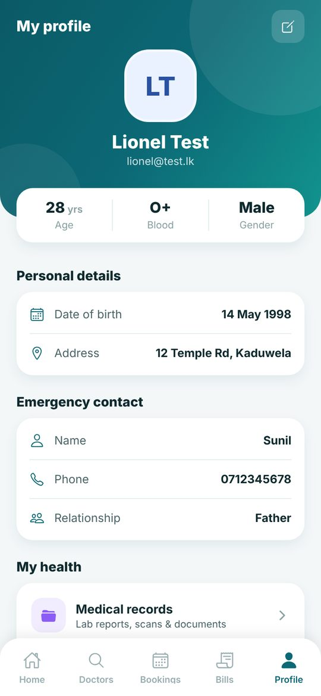<br/><sub>Profile</sub></td>
</tr>
</table>

### Doctor and admin

<table>
<tr>
<td align="center"><br/><sub>Doctor dashboard</sub></td>
<td align="center"><br/><sub>Admin dashboard</sub></td>
<td align="center">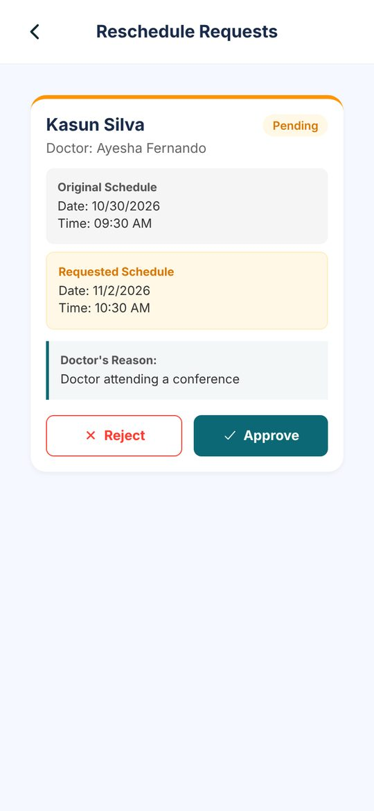<br/><sub>Reschedule requests</sub></td>
</tr>
</table>

---

## 10. Project structure

```
clinic-app/
├── backend/
│   ├── server.js                 Express app · DB connection · health route · exports app (Vercel)
│   ├── vercel.json               Region sin1
│   ├── config/cloudinary.js
│   ├── controllers/              auth · doctor · appointment · billing · patient ·
│   │                             prescription · medicalRecord · review · setting · holiday
│   ├── middleware/
│   │   ├── authMiddleware.js     protect (JWT + isActive) · authorize(roles)
│   │   ├── uploadMiddleware.js   multer memory storage, size and type limits
│   │   ├── errorMiddleware.js    404 + error handler
│   │   ├── validate.js           express-validator result → 422
│   │   └── validators/           per-resource rules
│   ├── models/                   User · Patient · Doctor · Appointment · Billing ·
│   │                             Prescription · MedicalRecord · Review · GlobalSetting · Holiday
│   ├── routes/                   one router per resource
│   ├── utils/clinicTime.js       clinic-timezone date maths
│   ├── utils/fileStorage.js      Cloudinary or local uploads
│   └── scripts/fixDatabase.js    one-off data repair
├── frontend/
│   ├── App.js                    AppNavigator + AlertHost
│   ├── app.json                  Expo config
│   └── src/
│       ├── api/axiosInstance.js
│       ├── navigation/AppNavigator.js
│       ├── components/           ui · AlertHost · DateField · Avatar · BrandLogo · Form*
│       ├── screens/
│       │   ├── auth/             Login · Register
│       │   ├── home/             Home · PatientAppointments · PatientBilling · Contact · Rating(s)
│       │   ├── doctors/          DoctorList · DoctorDetail (booking) · AddDoctor
│       │   ├── patients/         MyProfile · EditProfile · MedicalRecords · AddMedicalRecord · Prescriptions
│       │   ├── doctor/           DoctorDashboard · AllAppointments · DoctorPatientRecords
│       │   ├── prescriptions/    AddPrescription · PrescriptionDetail
│       │   └── admin/            Dashboard · Doctors · Patients · Appointments · Billing ·
│       │                         Prescriptions · Records · Reschedules · Settings · EditDoctor
│       ├── theme.js
│       └── utils/                date · validationSchemas
├── docs/screenshots/             images used in this README
└── render.yaml                   Render blueprint (optional)
```

---

## 11. Run it locally

**Requirements:** Node.js 20+, a MongoDB Atlas cluster (free M0), and Expo Go on your phone (SDK 54).

### Backend

```bash
cd backend
cp .env.example .env      # fill in MONGO_URI, JWT_SECRET, JWT_REFRESH_SECRET, ADMIN_EMAIL, ADMIN_PASSWORD
npm install
npm run dev               # http://localhost:5000 → open /api/health
```

The admin account from `ADMIN_EMAIL` / `ADMIN_PASSWORD` is created on first start.

| Variable | Required | Example / note |
|---|---|---|
| `MONGO_URI` | ✅ | `mongodb+srv://<user>:<password>@cluster0.xxxxx.mongodb.net/clinicdb` |
| `JWT_SECRET`, `JWT_REFRESH_SECRET` | ✅ | Long random strings, different from each other |
| `ADMIN_EMAIL`, `ADMIN_PASSWORD`, `ADMIN_NAME` | ✅ first run | Bootstrap admin login |
| `CLOUDINARY_CLOUD_NAME`, `CLOUDINARY_API_KEY`, `CLOUDINARY_API_SECRET` | on Vercel | Persistent uploads |
| `CORS_ORIGIN` | optional | Comma-separated web origins (default `*`) |
| `CLINIC_UTC_OFFSET_MINUTES` | optional | Default `330` (Sri Lanka) |

### App

```bash
cd frontend
cp .env.example .env      # EXPO_PUBLIC_API_URL=...
npm install
npx expo start            # scan the QR with Expo Go · press w for web
```

`EXPO_PUBLIC_API_URL` must end in `/api`:

- **Hosted:** `https://<project>.vercel.app/api`
- **Local:** `http://<your PC's IPv4>:5000/api` (phone and PC on the same Wi-Fi; find the IP with `ipconfig`)

Restart with `npx expo start -c` after changing `.env`. If Expo Go can't download the bundle on your network, try `npx expo start --tunnel`.

---

## 12. Deploy the backend

### Option A: Vercel (free, no card)

1. [vercel.com](https://vercel.com) → **Add New → Project** → import this repo.
2. **Root Directory:** `backend` · **Framework preset:** Express. Leave the build settings empty.
3. **Environment Variables:** same as `.env` (`MONGO_URI`, `JWT_*`, `ADMIN_*`) **plus the three `CLOUDINARY_*` keys**. Vercel has no disk, so uploads need Cloudinary.
4. Deploy → open `https://<project>.vercel.app/api/health` → expect `"database": "connected"`.
5. In MongoDB Atlas → **Network Access**, allow `0.0.0.0/0` (serverless IPs change).
6. Set `EXPO_PUBLIC_API_URL=https://<project>.vercel.app/api` in `frontend/.env`.

Notes: don't set `TZ` (Vercel reserves it; the API already uses clinic time). Uploads are limited to **4 MB** each on Vercel. The Hobby plan is for non-commercial use.

### Option B: Render

1. **New + → Blueprint** → select this repo (reads `render.yaml`).
2. Fill in `MONGO_URI`, `ADMIN_EMAIL`, `ADMIN_PASSWORD` (JWT secrets are generated for you), plus the Cloudinary keys for persistent uploads.
3. A free service sleeps after about 15 minutes idle, and the first request then takes 30–50 s. The app waits up to 60 s.

### Build an installable APK (optional)

```bash
npm i -g eas-cli && eas login
cd frontend && eas build -p android --profile preview   # needs an eas.json "preview" profile with buildType "apk"
```

---

## 13. Security and business rules

- **Passwords** are hashed with bcrypt. Registration requires 8+ characters with an uppercase letter, a lowercase letter, a number and a symbol.
- **JWT:** access token valid for 1 h, refresh token for 7 d. Refresh is refused for deactivated accounts.
- **Role-based access** on every route (`protect` + `authorize`). Controllers also **scope data to the caller**: patients only see their own appointments, bills, prescriptions and records.
- **Deactivated accounts** (patient removed by admin) get 403 on every request and can't log in.
- **Bookings** can't be in the past, outside the booking window, on holidays, on the doctor's days off, or on a slot that's already taken. All of this is enforced on the server, not only in the UI.
- **Soft deletes:** patients and doctors cancel appointments; only admins hard-delete.
- **Fees:** each doctor has their own `consultationFee`, which is used for auto-invoices.
- **Uploads:** type and size limits (images 5 MB, documents 10 MB; 4 MB on Vercel), stored on Cloudinary.
- **Secrets:** `.env` files are git-ignored. Use the `.env.example` templates and never commit real credentials. If a secret leaks, rotate it (Atlas → Database Access → edit the user's password) and update `MONGO_URI` everywhere.

---

<div align="center"><sub>Built with Expo, Express and MongoDB · © Adithya Bandara</sub></div>
